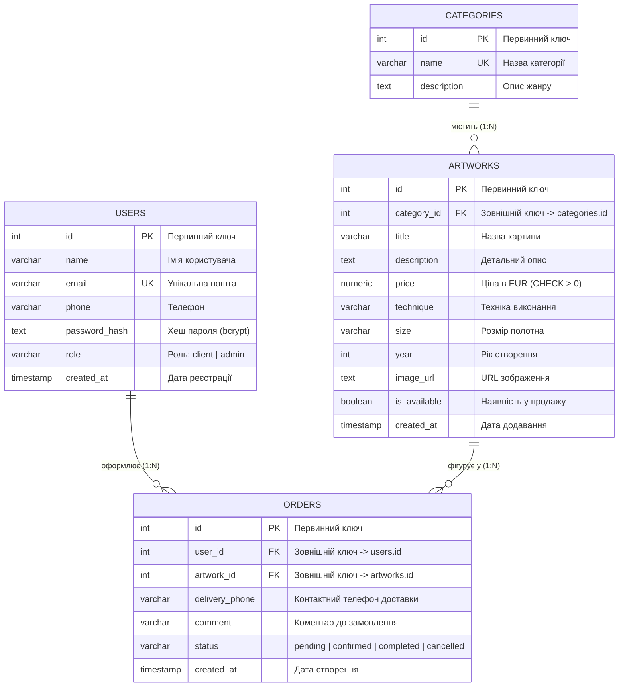

# Purrfect Art — Вебзастосунок та REST API галереї картин з котами

Повноцінний клієнт-серверний вебзастосунок галереї картин **«Purrfect Art»** (продовження Практикуму №1). Статичний фронтенд інтегровано з серверною частиною на **Node.js + Express**, реляційною базою даних **PostgreSQL** (у 3-й нормальній формі) та системою автентифікації на базі **JWT** і **bcrypt**.

---

## Зміст

1. [Технологічний стек та архітектура](#1-технологічний-стек-та-архітектура)
2. [Проєктування бази даних (ER-діаграма та 3НФ)](#2-проєктування-бази-даних-er-діаграма-та-3нф)
3. [Інструкція розгортання бази даних та сервера](#3-інструкція-розгортання-бази-даних-та-сервера)
4. [Документація REST API](#4-документація-rest-api)
5. [Приклади запитів та відповідей](#5-приклади-запитів-та-відповідей)

---

## 1. Технологічний стек та архітектура

* **Backend:** Node.js, Express.js (`express`, `cors`, `dotenv`)
* **База даних:** PostgreSQL 16 (драйвер `pg` із пулом з'єднань)
* **Безпека та автентифікація:** `jsonwebtoken` (Stateless Bearer JWT), `bcryptjs` (хешування паролів із сіллю, 10 раундів)
* **Frontend:** HTML5, CSS3, Vanilla JavaScript (`Fetch API`, динамічний рендеринг DOM, обробка станів завантаження та помилок)
* **Інфраструктура:** Docker & Docker Compose

### Структура проєкту

```text
purrfect-art/
├── db/
│   └── init.sql                 # DDL-схема БД (3НФ), обмеження цілісності та початкові дані
├── public/
│   └── index.html               # Клієнтська частина (SPA-навігація, Fetch API, авторизація)
├── src/
│   ├── config/
│   │   └── db.js                # Налаштування пулу підключень до PostgreSQL
│   ├── middleware/
│   │   ├── auth.js              # Перевірка JWT-токена та ролей (client / admin)
│   │   └── validate.js          # Серверна валідація параметрів та тіла HTTP-запитів
│   ├── routes/
│   │   ├── auth.js              # Ендпоінти реєстрації, входу та профілю користувача
│   │   ├── artworks.js          # Повний CRUD для сутності «Картини» та довідник категорій
│   │   └── orders.js            # Повний CRUD для сутності «Замовлення»
│   ├── utils/
│   │   └── seedAdmin.js         # Ініціалізація тестових акаунтів при першому запуску
│   └── server.js                # Точка входу Express, підключення маршрутів та error-handler
├── .env.example                 # Шаблон змінних середовища
├── .gitignore                   # Виключення node_modules та .env із Git
├── docker-compose.yml           # Конфігурація контейнера PostgreSQL 16
├── package.json                 # Залежності та npm-скрипти
└── README.md                    # Документація проєкту та API
```

---

## 2. Проєктування бази даних (ER-діаграма та 3НФ)

База даних `purrfect_art` складається з **4 пов'язаних таблиць** і відповідає **третій нормальній формі (3НФ)**:
* **1НФ:** усі атрибути атомарні, кожна таблиця має унікальний первинний ключ `id`.
* **2НФ:** усі первинні ключі є простими (`SERIAL PRIMARY KEY`), часткові залежності відсутні.
* **3НФ:** усунуто транзитивні залежності — категорії винесені у довідник `categories`, а дані замовника не дублюються в таблиці `orders` (зв'язок через `user_id`).



---

## 3. Інструкція розгортання бази даних та сервера

### Попередні вимоги
* **Node.js** версії `18.x` або новішої (`npm`)
* **Docker** та **Docker Compose** (або локально встановлений **PostgreSQL 14+**)

### Крок 1. Клонування репозиторію та встановлення залежностей

```bash
git clone https://github.com/jrnbkmjy144-maker/cat-gallery.git
cd purrfect-art
npm install
```

### Крок 2. Налаштування змінних середовища

Скопіюйте шаблон `.env.example` у файл `.env` та за потреби змініть значення:

```bash
cp .env.example .env
```

Вміст `.env` за замовчуванням:
```env
PORT=3000
DB_HOST=localhost
DB_PORT=5432
DB_NAME=purrfect_art
DB_USER=postgres
DB_PASSWORD=postgres
JWT_SECRET=super_secret_purrfect_art_key_2026
JWT_EXPIRES_IN=24h
```

### Крок 3. Розгортання бази даних PostgreSQL

#### Варіант А: Через Docker Compose (рекомендовано)
```bash
docker compose up -d
```
Під час першого запуску Docker автоматично створить базу `purrfect_art` та виконає скрипт `db/init.sql` (створить таблиці, зв'язки та додасть 3 категорії й 6 картин).

#### Варіант Б: Через локальний PostgreSQL
```bash
psql -U postgres -c "CREATE DATABASE purrfect_art;"
psql -U postgres -d purrfect_art -f db/init.sql
```

### Крок 4. Запуск серверної частини

```bash
npm start
```
Для розробки з автоматичним перезапуском при зміні коду:
```bash
npm run dev
```

Після запуску сервер буде доступний за адресою **`http://localhost:3000`**.

### Тестові облікові записи (створюються автоматично)
| Роль | Email | Пароль | Права доступу |
| :--- | :--- | :--- | :--- |
| **Адміністратор** | `admin@purrfect.art` | `Admin123!` | Повний CRUD для картин і замовлень |
| **Клієнт** | `client@purrfect.art` | `Client123!` | Оформлення та керування власними замовленнями |

---

## 4. Документація REST API

Базовий URL API: `http://localhost:3000/api`
Для захищених ендпоінтів необхідно передавати заголовок:
```http
Authorization: Bearer <ваш_JWT_токен>
```

### 4.1. Автентифікація та користувачі (`/api/auth`)

| Метод | Ендпоінт | Доступ | Опис | Статус-коди |
| :--- | :--- | :--- | :--- | :--- |
| `POST` | `/api/auth/register` | Публічний | Реєстрація нового користувача, хешування пароля (`bcrypt`) та видача JWT | `201`, `400`, `409` |
| `POST` | `/api/auth/login` | Публічний | Вхід користувача за email та паролем, отримання JWT-токена | `200`, `400`, `401` |
| `GET` | `/api/auth/me` | Bearer JWT | Отримання даних профілю поточного автентифікованого користувача | `200`, `401`, `404` |

### 4.2. Каталог картин (`/api/artworks`)

| Метод | Ендпоінт | Доступ | Опис | Статус-коди |
| :--- | :--- | :--- | :--- | :--- |
| `GET` | `/api/artworks/categories` | Публічний | Отримання довідника всіх категорій (жанрів) | `200`, `500` |
| `GET` | `/api/artworks` | Публічний | Отримання списку картин (підтримує query-фільтр `?category_id=1`) | `200`, `400`, `500` |
| `GET` | `/api/artworks/:id` | Публічний | Отримання детальної інформації про картину за її `id` | `200`, `400`, `404` |
| `POST` | `/api/artworks` | Bearer JWT (`admin`) | Створення нової картини в каталозі | `201`, `400`, `401`, `403` |
| `PUT` | `/api/artworks/:id` | Bearer JWT (`admin`) | Повне оновлення інформації про картину за `id` | `200`, `400`, `401`, `403`, `404` |
| `DELETE` | `/api/artworks/:id` | Bearer JWT (`admin`) | Видалення картини за `id` | `200`, `400`, `401`, `403`, `404` |

### 4.3. Замовлення (`/api/orders`)

| Метод | Ендпоінт | Доступ | Опис | Статус-коди |
| :--- | :--- | :--- | :--- | :--- |
| `GET` | `/api/orders` | Bearer JWT | Список замовлень (`client` бачить власні, `admin` — усі) | `200`, `401` |
| `GET` | `/api/orders/:id` | Bearer JWT | Детальна інформація про конкретне замовлення | `200`, `400`, `401`, `403`, `404` |
| `POST` | `/api/orders` | Bearer JWT | Створення нового замовлення на обрану картину | `201`, `400`, `401`, `404` |
| `PATCH` | `/api/orders/:id` | Bearer JWT | Часткове оновлення замовлення (`status`, `comment`, `delivery_phone`) | `200`, `400`, `401`, `403`, `404` |
| `DELETE` | `/api/orders/:id` | Bearer JWT | Видалення замовлення за `id` | `200`, `400`, `401`, `403`, `404` |

### 4.4. Службові ендпоінти

| Метод | Ендпоінт | Доступ | Опис | Статус-коди |
| :--- | :--- | :--- | :--- | :--- |
| `GET` | `/api/health` | Публічний | Перевірка працездатності сервера | `200` |

---

## 5. Приклади запитів та відповідей

### 5.1. Реєстрація користувача (`POST /api/auth/register`)

**Request Body:**
```json
{
  "name": "Артем",
  "email": "artem@example.com",
  "phone": "+380671234567",
  "password": "Password123"
}
```

**Response (`201 Created`):**
```json
{
  "message": "Реєстрація успішна",
  "token": "eyJhbGciOiJIUzI1NiIsInR5cCI6IkpXVCJ9...",
  "user": {
    "id": 3,
    "name": "Артем",
    "email": "artem@example.com",
    "phone": "+380671234567",
    "role": "client",
    "created_at": "2026-11-16T15:10:00.000Z"
  }
}
```

### 5.2. Додавання картини (`POST /api/artworks`)

**Headers:** `Authorization: Bearer <admin_token>`

**Request Body:**
```json
{
  "category_id": 1,
  "title": "Кіт-архітектор",
  "description": "Зосереджений кіт над кресленнями сучасного хмарочоса.",
  "price": 175,
  "technique": "Акрил",
  "size": "50x70 см",
  "year": 2026,
  "image_url": "https://i.pinimg.com/736x/e2/f4/87/e2f487b4265be2707d3321aa9c1864b1.jpg"
}
```

**Response (`201 Created`):**
```json
{
  "id": 7,
  "category_id": 1,
  "title": "Кіт-архітектор",
  "description": "Зосереджений кіт над кресленнями сучасного хмарочоса.",
  "price": "175.00",
  "technique": "Акрил",
  "size": "50x70 см",
  "year": 2026,
  "image_url": "https://i.pinimg.com/736x/e2/f4/87/e2f487b4265be2707d3321aa9c1864b1.jpg",
  "is_available": true,
  "created_at": "2026-11-16T15:15:00.000Z"
}
```

### 5.3. Створення замовлення (`POST /api/orders`)

**Headers:** `Authorization: Bearer <client_token>`

**Request Body:**
```json
{
  "artwork_id": 1,
  "delivery_phone": "+380671234567",
  "comment": "Доставка у Київ після 18:00"
}
```

**Response (`201 Created`):**
```json
{
  "message": "Замовлення успішно створено",
  "order": {
    "id": 1,
    "user_id": 2,
    "artwork_id": 1,
    "delivery_phone": "+380671234567",
    "comment": "Доставка у Київ після 18:00",
    "status": "pending",
    "created_at": "2026-11-16T15:20:00.000Z"
  }
}
```

### 5.4. Приклад відповіді при помилці валідації (`400 Bad Request`)

```json
{
  "error": "Помилка валідації картини",
  "details": [
    "Ціна повинна бути числом більшим за 0.",
    "Рік створення має бути цілим числом у діапазоні 1900–2100."
  ]
}
```
